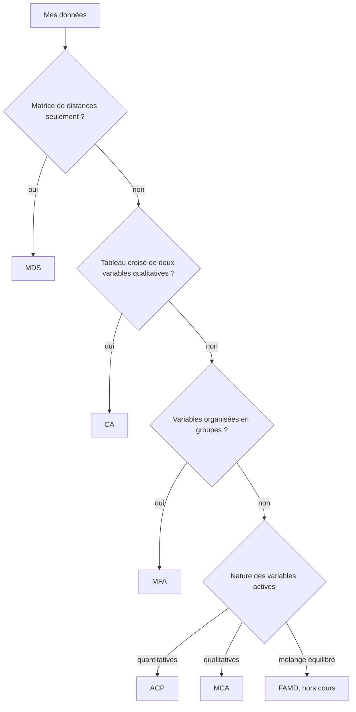

Retour : [AD](../AD.md) · Suivant : [Protocole - ACP](Protocole%20-%20ACP.md)

# Choisir une méthode factorielle

## Trois questions à se poser d'abord
1. **Que sont les lignes ?** Ce sont soit des individus statistiques, comme des patients ou des vins, soit les modalités d'une variable, comme dans un tableau croisé.
2. **Quelle est la nature des colonnes ?** Elles peuvent être quantitatives, qualitatives, mélangées, organisées en groupes, ou être déjà des distances.
3. **Quelle est la question ?** On peut chercher les ressemblances entre individus, les liaisons entre variables, la liaison entre deux variables qualitatives, ou comparer plusieurs points de vue sur les mêmes individus.

## Arbre de décision

## Table de décision

| Données | Méthode | Pourquoi | Protocole |
|---|---|---|---|
| $n \times p$ quantitatives | ACP | elle résume des variables corrélées par peu d'axes non corrélés | [Protocole - ACP](Protocole%20-%20ACP.md) |
| tableau de contingence $I \times J$ | CA | elle décompose l'écart à l'indépendance, mesuré par le $\chi^{2}$ | [Protocole - CA](Protocole%20-%20CA.md) |
| $n \times p$ qualitatives | MCA | elle traite le TDC et pondère les modalités rares | [Protocole - MCA](Protocole%20-%20MCA.md) |
| $n$ individus, variables en $J$ groupes | MFA | elle équilibre les groupes, qu'une ACP laisserait au plus gros | [Protocole - MFA](Protocole%20-%20MFA.md) |
| distances $d(i, i')$ seulement | MDS | elle retrouve des coordonnées à partir des distances | slides pas encore en ligne |
| quantitatives et qualitatives mélangées, sans groupes | FAMD | c'est une MFA avec une variable par groupe | hors cours |

## Cas mixtes du cours
- **Beaucoup de quantitatives et quelques qualitatives :** on fait une ACP sur les quantitatives et on met les qualitatives en supplémentaire.
- **Beaucoup de qualitatives et quelques quantitatives :** on fait une MCA et on met les quantitatives en supplémentaire. On peut aussi les découper en classes pour les rendre actives.
- **Deux variables qualitatives seulement :** la CA du tableau croisé suffit, voir [MCA - Lien avec la CA](ACM/MCA%20-%20Lien%20avec%20la%20CA.md).

## Le pipeline commun à toutes les méthodes

| Étape | Ce qu'on fait | Pourquoi |
|---|---|---|
| 1. Décrire | types, valeurs manquantes, valeurs extrêmes, distributions | une méthode factorielle amplifie les données mal codées |
| 2. Actifs et supplémentaires | on choisit qui construit les axes | les actifs définissent la ressemblance, les supplémentaires servent à l'expliquer |
| 3. Lancer | FactoMineR, `graph = FALSE` | on trace ensuite avec factoextra |
| 4. Nombre d'axes | éboulis, valeur propre moyenne, % cumulé | on ne lit que ce qui dépasse le bruit |
| 5. Nommer les axes | contributions, corrélations, `dimdesc` | un axe n'a de sens que si on sait ce qui le porte |
| 6. Lire les plans | seulement les points bien représentés, $\cos^{2}$ | un point mal projeté trompe |
| 7. Projeter les supplémentaires | barycentres, corrélations | on relie la structure trouvée à la question |
| 8. Conclure | on répond à la question en phrases | le correcteur veut une analyse, pas une lecture de sortie |

## Pièges de choix
- **La variable à expliquer va en supplémentaire.** Si elle est active, elle construit les axes et l'argument devient circulaire.
- **Un total et ses composantes, ou un ratio et ses termes, répètent la même information.** Ensemble, ils créent un axe artificiel. On en garde un en actif et l'autre en supplémentaire.
- **Une méthode factorielle explore, elle ne teste rien.** Pour conclure qu'une liaison existe, on fait un test, comme le $\chi^{2}$ en [CA - Test du khi-deux d'indépendance](AFC/CA%20-%20Test%20du%20khi-deux%20d%27ind%C3%A9pendance.md).
- **Les coordonnées des premiers axes sont quantitatives.** Elles servent souvent d'entrée à un clustering, c'est le lien avec la deuxième partie de l'UF.
