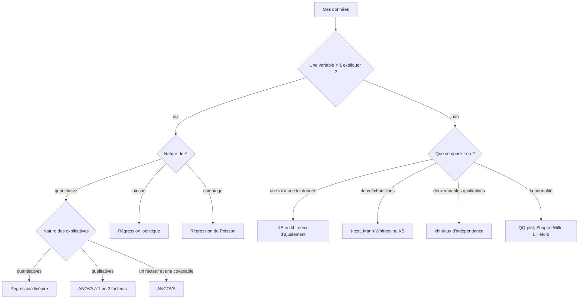

Retour : [EMS](../EMS.md) · Suivant : [Protocole - Régression linéaire](Protocole%20-%20R%C3%A9gression%20lin%C3%A9aire.md)

# Choisir un modèle ou un test

## Trois questions à se poser d'abord
1. **Y a-t-il une variable à expliquer $Y$ ?** Si oui, on modélise. Sinon, on teste une hypothèse sur une ou plusieurs distributions.
2. **Quelle est la nature de $Y$ ?** Elle peut être quantitative continue, binaire ou un comptage.
3. **Quelle est la nature des explicatives ?** Elles peuvent être toutes quantitatives, toutes qualitatives ou mélangées.

## Arbre de décision

## Pourquoi tel modèle

| Situation | Modèle | Pourquoi |
|---|---|---|
| $Y$ quantitative, $X$ quantitatives | régression linéaire | $\mathbb{E}[Y]$ est une combinaison linéaire des $X^{(j)}$ |
| $Y$ quantitative, facteurs qualitatifs | ANOVA | on compare les moyennes des groupes avec un seul test F |
| $Y$ quantitative, un facteur et une covariable | ANCOVA | on compare les groupes à covariable égale |
| $Y$ binaire | logistique | un modèle linéaire prédirait des probabilités hors de $[0,1]$, le logit envoie $]0,1[$ sur $\mathbb{R}$ |
| $Y$ comptage | Poisson | le lien log garantit $\lambda > 0$ |

Régression, ANOVA et ANCOVA sont le même modèle $Y = X\theta + \varepsilon$ avec $\varepsilon \sim \mathcal{N}_{n}(0, \sigma^{2}I_{n})$, voir intro p. 18. Seule la matrice $X$ change. On teste donc toujours de la même façon, avec le test de Fisher entre deux modèles emboîtés.

Avec $I$ groupes, faire tous les t-tests deux à deux augmente le risque de conclure à tort qu'un effet existe. Le test F de l'ANOVA pose une seule question : toutes les moyennes sont-elles égales ? Cet argument ne figure pas dans les slides.

## Pipeline commun aux modèles

| Étape | Ce qu'on fait | Pourquoi |
|---|---|---|
| 1. Décrire | graphes de $Y$ contre chaque explicative | on voit la forme du lien avant de l'imposer |
| 2. Écrire le modèle | équation, hypothèses, contraintes | le rapport et l'examen le demandent |
| 3. Ajuster | `lm` ou `glm` | |
| 4. Valider | résidus, hypothèses H1 à H4 | un test F n'a de sens que si les hypothèses tiennent |
| 5. Tester et simplifier | modèles emboîtés, puis sélection | on garde le modèle le plus simple qui explique autant |
| 6. Interpréter | coefficients, odds ratios, intervalles | on répond à la question en phrases |

## Protocoles
- [Protocole - Régression linéaire](Protocole%20-%20R%C3%A9gression%20lin%C3%A9aire.md)
- [Protocole - ANOVA](Protocole%20-%20ANOVA.md)
- [Protocole - ANCOVA](Protocole%20-%20ANCOVA.md)
- [Protocole - Régression logistique et de Poisson](Protocole%20-%20R%C3%A9gression%20logistique%20et%20de%20Poisson.md)
- [Protocole - Tests de comparaison et d'adéquation](Protocole%20-%20Tests%20de%20comparaison%20et%20d%27ad%C3%A9quation.md)

## Pièges R vérifiés
Chaque point a été vérifié dans R 4.6, le plus souvent en refaisant l'exemple des slides.

| Piège | Conséquence | Fiche |
|---|---|---|
| `chisq.test` sur un tableau 2×2 applique la correction de Yates | slide 26 du khi-deux : 3.69 et $p = 0.055$ au lieu de 4.51 et $p = 0.034$ | [Protocole - Tests de comparaison et d'adéquation](Protocole%20-%20Tests%20de%20comparaison%20et%20d%27ad%C3%A9quation.md) |
| `anova(modele)` sur un seul modèle fait des tests séquentiels | sur un plan déséquilibré, le résultat dépend de l'ordre des termes | [Protocole - ANOVA](Protocole%20-%20ANOVA.md) |
| `stepAIC(..., p = log(n))` ignore `p` | il fait un AIC, pas un BIC, il faut écrire `k = log(n)` | [Protocole - Régression linéaire](Protocole%20-%20R%C3%A9gression%20lin%C3%A9aire.md) |
| `glm` binomial avec un facteur | il modélise la probabilité du 2e niveau | [Protocole - Régression logistique et de Poisson](Protocole%20-%20R%C3%A9gression%20logistique%20et%20de%20Poisson.md) |
| `ks.test` avec moyenne et variance estimées | sous $\mathcal{H}_{0}$, le niveau réel tombe à 0.03 % au lieu de 5 % | [Protocole - Tests de comparaison et d'adéquation](Protocole%20-%20Tests%20de%20comparaison%20et%20d%27ad%C3%A9quation.md) |
| `t.test` à deux échantillons | fait un test de Welch par défaut, pas le test à variance commune du cours | [Protocole - Tests de comparaison et d'adéquation](Protocole%20-%20Tests%20de%20comparaison%20et%20d%27ad%C3%A9quation.md) |
